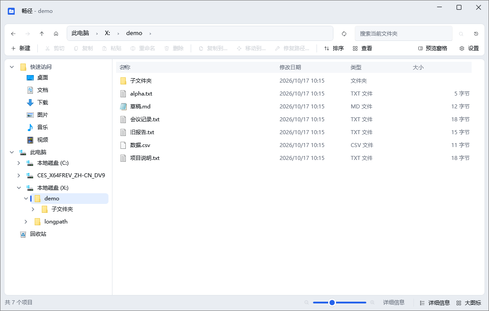

# 畅径

一个 Windows 长路径文件管理器，用来处理资源管理器打不开、删不掉、移不走的文件。完全本地运行，不联网，不收集任何数据。

仓库地址：https://github.com/GitHubMacrro/changjing-file-manager · 作者：鱼塘泛舟-SQ



## 它能解决什么

Windows 资源管理器对很长的路径和特殊名字支持不好。遇到下面这些情况，文件往往打不开、删不掉、移不走：

- 完整路径超过 260 个字符
- 文件名是系统保留字，如 `CON`、`NUL`、`PRN`、`AUX`、`COM1`、`LPT1`
- 文件名以点 `.` 或空格结尾

畅径能直接浏览、复制、移动、重命名、删除这些文件，并提供一个「修复路径」工具，把它们改成资源管理器也能用的名字。修好之后照常回到资源管理器操作。

## 主要功能

- 浏览文件，支持超长路径与特殊名称
- 复制、剪切、粘贴、重命名、删除
- 复制到… / 移动到…
- 撤销 / 重做
- 拖放（含拖出到其它程序，只复制不移动）
- 多选：项目复选框、框选、Ctrl 追加、Ctrl+Space、Ctrl+A、Esc、反向选择
- 递归搜索子文件夹，结果高亮关键词、显示所在文件夹
- 预览窗格（图片 / 文本 / PDF / 系统预览处理器）
- 8 种视图、排序、分组、图标缩放
- 程序自有回收站（还原 / 永久删除 / 清空）
- 「修复路径」工具
- 以管理员身份重新打开
- 右键「用畅径打开」
- 命令行位置参数

## 下载与安装

到项目的 [Releases](https://github.com/GitHubMacrro/changjing-file-manager/releases) 页面下载：

- 64 位系统：选 `x64` 版本
- 较旧的 32 位系统：选 `x86` 版本

每个架构都提供两种形式：

- 安装版（`ChangJing-Setup-*.exe`）：像普通软件一样安装，会创建开始菜单项和可选桌面快捷方式，可勾选添加右键菜单「用畅径打开」
- 绿色版（`ChangJing-*-portable.zip`）：解压后直接运行 `ChangJing.exe`，无需安装

两种形式都自带了运行环境，不需要另外安装 .NET。绿色版的设置和日志同样存放在 `%LOCALAPPDATA%\ChangJing`。

下载后可以用同一目录下的 `SHA256SUMS.txt` 校验文件是否完整：里面列出了每个安装包和绿色版的 SHA256，用系统自带的 `certutil -hashfile 文件名 SHA256` 即可比对。

### 系统要求

Windows 10 或更高版本。

## 首次运行提示

第一次运行时，Windows 可能弹出「Windows 已保护你的电脑」的蓝色提示。这是因为畅径暂未做代码签名，属于正常现象。处理方法：

1. 点提示框里的「更多信息」
2. 再点「仍要运行」

之后就能正常使用。

## 右键「用畅径打开」

安装时如果勾选了「添加右键菜单『用畅径打开』」，那么在文件夹、文件夹空白处、驱动器、文件上右键，都能看到「用畅径打开」。

Windows 11 上要先点右键菜单里的「显示更多选项」，才能看到「用畅径打开」。

## 隐私

畅径完全在本地运行，不联网，不收集任何数据。它不会发送遥测、不检查更新、不连接任何服务器。只有你主动点击「设置 → 关于」页里的「项目主页」「反馈问题」等按钮时，才会用默认浏览器打开对应链接。

相关文件位置：

- 设置：`%LOCALAPPDATA%\ChangJing\settings.json`
- 日志：`%LOCALAPPDATA%\ChangJing\logs` 文件夹里的日志文件

## 卸载

- Windows 10：「设置 → 应用 → 应用和功能」
- Windows 11：「设置 → 应用 → 已安装的应用」

在列表里找到「畅径」卸载即可。

- 畅径回收站里的文件不会被删除，仍保留在各磁盘根目录的 `X:\$ChangJing.Recycle` 文件夹里。需要的话可以手动清理
- 卸载时会询问是否同时删除设置和日志，默认不删除
- 绿色版直接删除程序文件夹即可

## 使用手册

完整的功能说明、操作步骤和注意事项见 [docs/使用手册.md](docs/使用手册.md)。

## 从源码构建

需要：

- [.NET 8 SDK](https://dotnet.microsoft.com/download/dotnet/8.0)
- 出安装包时需要 [Inno Setup 6](https://jrsoftware.org/isinfo.php)

```powershell
# 构建
dotnet build ChangJing.sln

# 运行
dotnet run --project ChangJing.App

# 运行回归测试
powershell -File tests\run-regression.ps1

# 生成安装包（输出到 deliver\1.1.0\）
powershell -File installer\build-installer.ps1

# 由使用手册生成安装包内的使用说明（installer\使用说明.html）
powershell -File installer\build-help.ps1
```

## 反馈问题

请到项目的 [Issues](https://github.com/GitHubMacrro/changjing-file-manager/issues) 页面反馈，并尽量附上：

- 你做了什么操作、看到什么、期望什么
- 「设置 → 关于 → 复制版本信息」复制出来的版本信息
- 日志文件夹 `%LOCALAPPDATA%\ChangJing\logs` 里的日志文件

## 许可证

畅径以 MIT 许可证开源，版权归 鱼塘泛舟-SQ (GitHubMacrro) 所有，详见 [LICENSE](LICENSE)。

随程序分发的第三方组件许可原文见 [licenses/](licenses/)。
