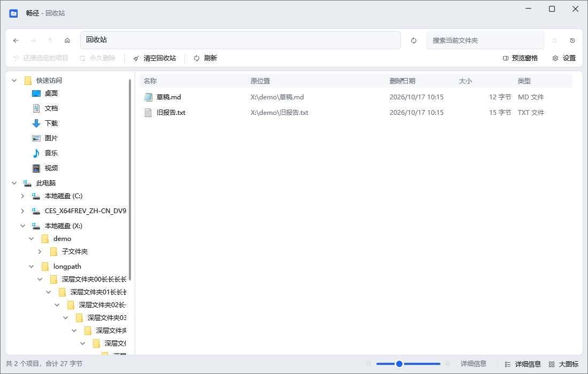
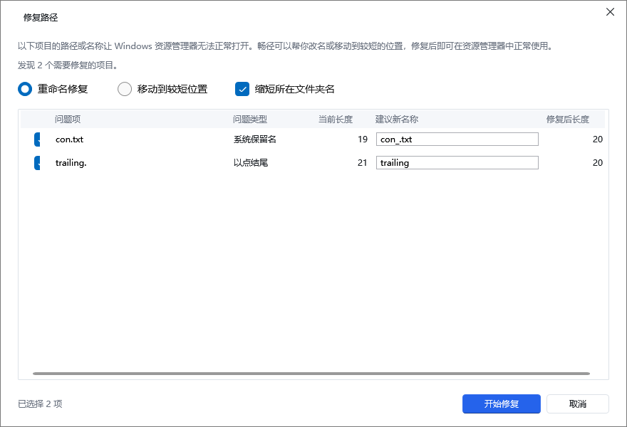
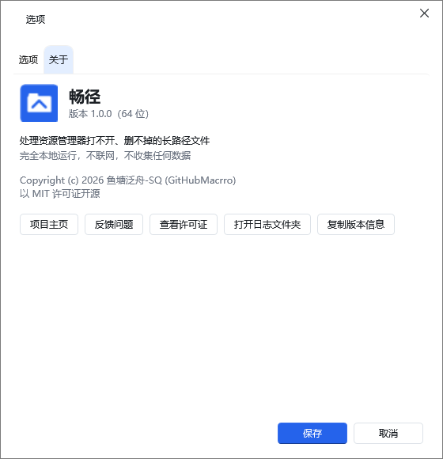

# 畅径 使用手册

版本 1.0.0 · 适用系统：Windows 10 或更高版本

---

## 一、畅径是什么

畅径是一个 Windows 文件管理器，用来处理资源管理器处理不了的文件。

Windows 资源管理器对「很长的路径」和「特殊名字」支持不好。当文件放在很深的文件夹里（完整路径超过 260 个字符），或者名字是 `con`、`nul` 这类系统保留字，或者名字以点 `.`、空格结尾时，资源管理器可能会：

- 打不开、复制失败、删不掉、移不动
- 报「找不到文件」「路径太长」「文件名无效」之类的含糊错误
- 甚至整个文件夹都进不去

畅径可以直接浏览、复制、移动、重命名、删除这些文件，还提供了一个「修复路径」工具，把它们改成资源管理器也能正常用的名字。修好之后，你就能继续用熟悉的资源管理器了。

畅径**完全在本地运行，不联网，不收集任何数据**。


---

## 二、界面介绍

主窗口从上到下分成几块：

- **标题栏**：显示「畅径 - 位置」。以管理员身份运行时显示「畅径（管理员） - 位置」，并在图标旁带一个小盾牌
- **工具栏第一行**：左边是后退 / 前进 / 上一级 / 主页按钮，中间是地址栏，右边是刷新、搜索框、搜索按钮、搜索历史
- **工具栏第二行**：新建、剪切、复制、粘贴、重命名、删除、复制到…、移动到…、修复路径…、排序、查看，最右侧是「预览窗格」开关和「设置」按钮
- **主体区域**：左边是导航树（快速访问、此电脑、回收站），中间是文件列表，右边是预览窗格（默认关闭）
- **状态栏**：显示当前项目数量，以及右下角的图标缩放和视图切换按钮

「设置」按钮在**所有页面**都显示（包括回收站、搜索结果和此电脑），点一下就能打开选项窗口。

「修复路径…」按钮只在**能用的页面**显示，也就是打开某个文件夹时（以及搜索结果里）。在「此电脑」和「回收站」页面不会出现。

---

## 三、浏览与地址栏

### 打开位置

- 双击文件夹进入，双击文件用默认程序打开；选中后按 <kbd>Enter</kbd> 也可以
- 左侧导航树点「快速访问」「此电脑」「回收站」可直接跳转
- 双击「此电脑」页面里的驱动器和常用文件夹可以进入

### 地址栏

- 地址栏是一格一格的「面包屑」，点某一格跳到那一层
- 每一格后面有个小箭头 `›`，点它会列出该层的子文件夹，可以直接跳过去
- 想直接输入路径：点地址栏空白处，或按 <kbd>Ctrl+L</kbd> / <kbd>Alt+D</kbd> / <kbd>F4</kbd>，然后粘贴或输入完整路径回车
- **粘贴长路径**：直接把完整路径（可以是超过 260 字符的路径，也可以带 `\\?\` 前缀）粘进地址栏回车即可，畅径会自动处理
- 地址栏只显示正常路径，**从不显示** `\\?\` 这类内部前缀；把鼠标停在地址栏上能看到完整路径

---

## 四、常用文件操作

| 你想做什么 | 怎么做 |
|---|---|
| 打开文件 / 进入文件夹 | 双击，或选中后按 <kbd>Enter</kbd> |
| 后退 / 前进 / 上一级 | 工具栏按钮，或 <kbd>Alt+←</kbd> / <kbd>Alt+→</kbd> / <kbd>Alt+↑</kbd> |
| 刷新 | <kbd>F5</kbd> 或 <kbd>Ctrl+R</kbd> |
| 重命名 | 选中按 <kbd>F2</kbd>，改完按 <kbd>Enter</kbd> |
| 新建文件夹 | <kbd>Ctrl+Shift+N</kbd> |
| 删除（进畅径回收站） | <kbd>Delete</kbd> |
| 永久删除（不进回收站） | <kbd>Shift+Delete</kbd>（会先确认） |
| 撤销 / 重做 | <kbd>Ctrl+Z</kbd> / <kbd>Ctrl+Y</kbd> |

### 新建

工具栏「新建」按钮或列表空白处右键「新建」，可以新建文件夹、快捷方式，也可以新建系统里注册过的文件类型（如文本文档、位图图像）。菜单里的内容跟随系统。

### 复制 / 剪切 / 粘贴

选中若干项，<kbd>Ctrl+C</kbd> 后在目标文件夹 <kbd>Ctrl+V</kbd>；或者 <kbd>Ctrl+X</kbd> 剪切后再粘贴。剪切的项会显示半透明。

### 复制到… / 移动到…

选中项后点工具栏「复制到…」或「移动到…」，会弹出一个目标选择器，里面有最近用过位置、常用位置和各磁盘。选好后即可复制或移动过去。

### 重命名

选中按 <kbd>F2</kbd> 直接改名；若名字非法（含系统保留字、以点结尾等），输入框下方会给出提示。

### 删除

- 按 <kbd>Delete</kbd>：文件进入畅径回收站，底部出现提示条「已将 N 个项目移到回收站 [撤销]」，5 秒后消失。点「撤销」可立即还原
- 按 <kbd>Shift+Delete</kbd>：永久删除，会先弹确认框（默认按钮「否」）

### 撤销 / 重做

复制、移动、重命名、删除等操作都可以撤销。<kbd>Ctrl+Z</kbd> 撤销，<kbd>Ctrl+Y</kbd> 重做。撤销历史只在本次运行内有效，关闭程序后清空。永久删除不会进入撤销栈。

---

## 五、拖放

- 把文件拖到文件夹、导航树节点、或「此电脑」里的驱动器上即可
- 同一磁盘内拖动默认是**移动**，跨磁盘默认是**复制**
- 按住 <kbd>Ctrl</kbd> = 复制，<kbd>Shift</kbd> = 移动，<kbd>Alt</kbd> = 创建快捷方式
- 拖到自身或自己的子文件夹会被禁止（显示禁止光标）
- 把文件拖出到其它程序（如桌面）**只会复制**，绝不会移动或删除源文件

---

## 六、搜索

- **当前文件夹即时筛选**：在搜索框输入关键词，列表即时过滤，不进入子文件夹
- **递归搜索子文件夹**：输入关键词后按 <kbd>Enter</kbd>，或在搜索框右侧点「在子文件夹中搜索」按钮，畅径会扫描当前文件夹及其所有子文件夹
- 搜索结果用单独的列表显示，会多出一列「所在文件夹」，命中的关键词会高亮显示
- 搜索过程中可以点「暂停搜索」暂停，点「取消搜索」或按 <kbd>Esc</kbd> 退出
- 搜索框右侧的「搜索历史」按钮可以查看最近搜索过的关键词，也可以清除历史

---

## 七、预览窗格

按 <kbd>Alt+P</kbd> 或点工具栏最右侧的「预览窗格」开关。

- 选中一个文件时，右侧显示预览：图片、文本、PDF 会直接渲染；其它类型会尝试调用系统的预览处理器（如果系统装了）
- 选中多个文件时显示「已选择多项」
- 预览是只读的，不会锁定文件，你在别处仍可修改或删除它
- 预览 PDF、文本等会在临时目录生成副本，关闭程序时会自动清理

---

## 八、视图与排序

点工具栏「查看」或「排序」，也可以在列表空白处右键选择。视图有 8 种：

| 快捷键 | 视图 |
|---|---|
| <kbd>Ctrl+Shift+1</kbd> | 超大图标 |
| <kbd>Ctrl+Shift+2</kbd> | 大图标 |
| <kbd>Ctrl+Shift+3</kbd> | 中等图标 |
| <kbd>Ctrl+Shift+4</kbd> | 小图标 |
| <kbd>Ctrl+Shift+5</kbd> | 列表 |
| <kbd>Ctrl+Shift+6</kbd> | 详细信息 |
| <kbd>Ctrl+Shift+7</kbd> | 平铺 |
| <kbd>Ctrl+Shift+8</kbd> | 内容 |

- 用 <kbd>Ctrl+滚轮</kbd>，或状态栏右下角的缩放滑块 / 加减按钮，可以调整图标大小（16～256）
- 「查看」菜单里还有「紧凑模式」，让详细信息行更紧凑
- 排序可以按名称、修改日期、类型、大小、所在文件夹，可分别选升序或降序
- 可以按名称、修改日期、类型、大小、所在文件夹分组显示
- 每个文件夹的视图和排序会被记住，下次打开同一个文件夹还是上次的样子

---

## 九、回收站

畅径有自己独立的回收站（不占用系统回收站），位于每个磁盘根目录下的隐藏文件夹 `X:\$ChangJing.Recycle`，只有当前用户和系统账户能访问。

- 左侧导航点「回收站」进入回收站页面
- 页面列出所有已删除项目：名称、原位置、删除日期、大小、类型
- **还原**：选中后点「还原选定的项目」。若原文件夹已被删除，畅径会自动重建；若目标位置已有同名项目，会弹出冲突对话框（替换 / 跳过 / 保留两者）
- **永久删除**：选中后点「永久删除」，会先确认，删除后不可恢复
- **清空回收站**：点「清空回收站」，会先确认，删除后不可恢复
- 回收站有容量上限（默认各卷容量的 10%，可在「设置 → 选项」里改成固定大小），超出时会自动清理最早删除的项目
- **U 盘 / 网络盘 / 光盘**上的文件删除时不进回收站，会提示将被永久删除

> 卸载畅径时，畅径回收站里的文件**不会被删除**，仍保留在各磁盘的 `$ChangJing.Recycle` 文件夹里。



---

## 十、修复路径工具

这是畅径的核心功能。当你看到列表里某个文件的名称后面有个橙色的「超长」小标签，或某个文件在资源管理器里打不开时，就可以用它。



### 打开方式

1. 选中一个或多个问题项，右键 →「修复路径…」
2. 点工具栏的「修复路径…」按钮：有选中项时分析选中项，没有选中项时**扫描当前文件夹**并列出所有问题项
3. 预览窗格里选中问题项后，点提示卡上的「修复…」按钮

### 它能修什么

- **路径过长**：完整路径超过 260 个字符，导致资源管理器打不开
- **系统保留名**：名字是 `CON`、`PRN`、`AUX`、`NUL`、`COM1`～`COM9`、`LPT1`～`LPT9` 等
- **以点或空格结尾**：如 `readme.`、`readme `

### 对话框里能做什么

- 列表会列出每个问题项、问题类型、当前长度和「建议新名称」
- 「建议新名称」可以直接编辑，如果仍然非法会标红提示
- 修复方式有两种：
  - **重命名修复**（默认）：就地改名，让路径变短、名字变合法。超长文件会在文件名中间插入省略号 `…` 并保留扩展名
  - **移动到较短位置**：把文件移动到一个更短的文件夹（默认「桌面\畅径修复」，可以改）
- 如果上级文件夹本身也太长，可以勾选「缩短所在文件夹名」，一并把上级文件夹改名变短
- 点「开始修复」，完成后显示「已修复 N 项，现在可以在资源管理器中打开」，并提供「打开所在文件夹」按钮
- 整批修复算**一步**，按 <kbd>Ctrl+Z</kbd> 可一次性全部还原，<kbd>Ctrl+Y</kbd> 重做

### 失败了怎么办

如果某个项目未能修复（例如目标新名称已被占用、文件被其它程序占用、没有权限），对话框会列出失败的项目和原因。你可以：

- 换一个「建议新名称」再试
- 先关闭占用文件的程序
- 如果是权限问题，用「以管理员身份重新打开」后再试

修复只改**名称**或**位置**，不改文件内容，时间戳也会保留。

---

## 十一、以管理员身份重新打开

畅径默认以普通权限运行。当你对需要管理员权限的文件夹（如 `C:\Program Files` 下的某些项）执行新建、重命名、粘贴、删除等操作时，会弹出「需要管理员权限」提示框，提供三个选择：

- **以管理员身份重新打开**：新开一个畅径窗口（标题栏显示「畅径（管理员） - 位置」并带小盾牌），定位到该文件夹；当前窗口不会关闭，正在进行的任务不会丢失。系统会弹出 UAC，点「是」即可；点「否」则静默返回，不报错
- **跳过**：放弃这一次操作，不报错
- **取消**：取消整个操作

如果你已经用「以管理员身份运行」启动了畅径，标题栏会显示「畅径（管理员）」，提示框里也不会再出现提权按钮。

---

## 十二、右键「用畅径打开」

安装时如果勾选了「添加右键菜单『用畅径打开』」，那么在文件夹、文件夹空白处、驱动器、文件上右键，都能看到「用畅径打开」：

- 对文件夹 / 空白处右键：用畅径打开该文件夹
- 对驱动器右键：用畅径打开该磁盘根目录
- 对文件右键：用畅径打开它所在的文件夹，并选中该文件

Windows 11 上要先点右键菜单里的「显示更多选项」，才能看到「用畅径打开」。

---

## 十三、命令行用法

畅径接受一个位置参数：

```text
ChangJing.exe "C:\某个文件夹"
ChangJing.exe "C:\某个文件夹\某个文件.txt"
```

- 参数是文件夹 → 打开该文件夹
- 参数是文件 → 打开它所在的文件夹并选中它
- 参数可以是普通路径、长路径、UNC 路径，也可以带 `\\?\` 前缀
- 参数不存在时，会在默认位置（此电脑）打开，并提示「找不到路径」

---

## 十四、设置

点工具栏最右侧的「设置」按钮打开选项窗口。窗口分成「选项」和「关于」两个分页。

### 选项分页

- **外观 - 主题**：跟随系统 / 浅色 / 深色，保存后立即生效
- **回收站容量**：可选「卷容量百分比」（默认 10%，0 表示不限制）或「固定大小」（GB）。超出上限时自动清理最早删除的项目
- **删除**：勾选「删除时不进回收站，直接永久删除」后，普通的 <kbd>Delete</kbd> 也会永久删除（每次仍会确认）

### 关于分页

- 显示应用图标、名称和版本号，例如「版本 1.0.0（64 位）」，32 位版显示「32 位」
- 一句话说明：处理资源管理器打不开、删不掉的长路径文件
- 隐私说明：完全本地运行，不联网，不收集任何数据
- 版权行和「以 MIT 许可证开源」
- 按钮：
  - **项目主页**：打开项目主页
  - **反馈问题**：打开问题反馈页
  - **查看许可证**：打开安装目录里的许可文件（`LICENSE.txt` 或 `licenses\`；找不到时打开 GitHub 上的许可证）
  - **打开日志文件夹**：打开日志所在文件夹
  - **复制版本信息**：把版本、位数和 Windows 版本号复制到剪贴板，复制后按钮旁提示「已复制」

程序不会自动联网，只有你点上面这些按钮时，才会用默认浏览器或默认程序打开对应内容。



---

## 十五、快捷键表

| 快捷键 | 作用 |
|---|---|
| <kbd>Enter</kbd> | 打开选中的文件 / 进入文件夹 |
| <kbd>Backspace</kbd> | 后退 |
| <kbd>Alt+←</kbd> / <kbd>Alt+→</kbd> | 后退 / 前进 |
| <kbd>Alt+↑</kbd> | 上一级 |
| <kbd>F4</kbd> / <kbd>Alt+D</kbd> / <kbd>Ctrl+L</kbd> | 聚焦地址栏（可输入完整路径） |
| <kbd>Ctrl+F</kbd> / <kbd>Ctrl+E</kbd> / <kbd>F3</kbd> | 聚焦搜索框 |
| <kbd>F5</kbd> / <kbd>Ctrl+R</kbd> | 刷新 |
| <kbd>F2</kbd> | 重命名 |
| <kbd>Ctrl+Shift+N</kbd> | 新建文件夹 |
| <kbd>Ctrl+C</kbd> / <kbd>Ctrl+X</kbd> / <kbd>Ctrl+V</kbd> | 复制 / 剪切 / 粘贴 |
| <kbd>Ctrl+Shift+C</kbd> | 复制选中项的完整路径 |
| <kbd>Delete</kbd> | 删除到回收站 |
| <kbd>Shift+Delete</kbd> | 永久删除（需确认） |
| <kbd>Ctrl+Z</kbd> / <kbd>Ctrl+Y</kbd> | 撤销 / 重做 |
| <kbd>Ctrl+A</kbd> | 全选 |
| <kbd>Alt+Enter</kbd> | 属性 |
| <kbd>Alt+P</kbd> | 打开 / 关闭预览窗格 |
| <kbd>Shift+F10</kbd> 或菜单键 | 打开右键菜单 |
| <kbd>Esc</kbd> | 取消搜索 / 关闭当前下拉 |
| <kbd>Ctrl+Shift+1</kbd> ~ <kbd>Ctrl+Shift+8</kbd> | 切换 8 种视图 |
| <kbd>Ctrl+滚轮</kbd> | 放大 / 缩小图标 |

---

## 十六、常见问题

**Q：畅径会不会修改我的文件内容？**

不会。畅径只做浏览、复制、移动、重命名、删除这类操作，从不修改文件内容。

**Q：为什么有些文件删不掉？**

文件可能正被其它程序占用。畅径会提示占用它的程序名，请先关闭该程序再试。若是权限问题，会弹出管理员权限提示框。

**Q：修复路径改了名字，会不会影响文件内容？**

不会。修复只改名称或位置，内容、时间戳都保留。改错了按 <kbd>Ctrl+Z</kbd> 可以整批还原。

**Q：预览会锁定文件吗？**

不会。预览打开的是只读流，随时可以在其它程序里修改或删除该文件。

**Q：畅径的回收站和系统回收站是一回事吗？**

不是。畅径有自己独立的回收站，用畅径删除的文件只能从畅径的「回收站」页面还原。

**Q：撤销能持续多久？**

撤销历史只在本次运行内有效，关闭程序后清空。永久删除不进撤销栈。

**Q：设置和日志在哪里？**

- 设置：`%LOCALAPPDATA%\ChangJing\settings.json`
- 日志：`%LOCALAPPDATA%\ChangJing\logs` 文件夹里的日志文件（需要反馈问题时请一并提供）

**Q：怎么切换浅色 / 深色？**

点工具栏最右侧的「设置」，在「选项 → 外观」里选「跟随系统 / 浅色 / 深色」。

**Q：畅径会联网吗？**

不会。畅径完全在本地运行，不联网，不收集任何数据。只有在「设置 → 关于」页主动点「项目主页」「反馈问题」这类按钮时，才会用默认浏览器打开对应链接。

---

## 十七、反馈问题

遇到问题时，请记录：

1. 你做了什么操作
2. 实际看到什么（可以截图）
3. 期望看到什么

并附上：

- 「设置 → 关于 → 复制版本信息」复制出来的版本信息
- 日志文件夹 `%LOCALAPPDATA%\ChangJing\logs` 里的日志文件

把这些发到项目的问题反馈页，能帮助我们定位问题。

---

## 十八、卸载

卸载路径：

- Windows 10：「设置 → 应用 → 应用和功能」
- Windows 11：「设置 → 应用 → 已安装的应用」

在列表里找到「畅径」点卸载即可。

- 卸载时会提示畅径回收站里还有多少个已删除项目，这些文件**不会被删除**，仍保留在各磁盘的 `$ChangJing.Recycle` 文件夹里
- 卸载时会询问是否同时删除设置和日志（默认「否」）。选择「是」会删除 `%LOCALAPPDATA%\ChangJing` 下的设置、日志与临时数据；选择「否」则保留，重装后可以继续使用
- 绿色版（便携版）直接删除程序文件夹即可，但同样不会删除畅径回收站里的文件
